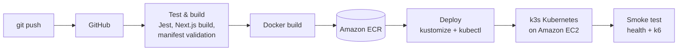
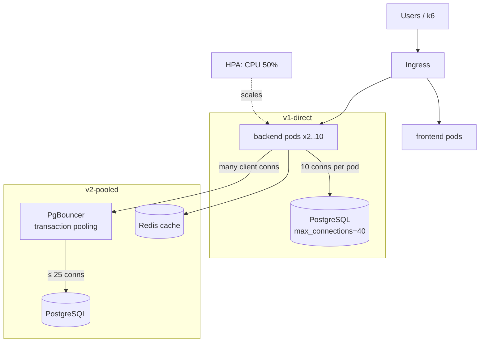

# Horizontal Pod Autoscaling and Database Bottleneck Management in Kubernetes Under High Traffic

**Repository:** https://github.com/Arnab-Afk/devops-lab-ca
**Author:** Arnab Bhowmik

## 1. Problem statement

The Kubernetes Horizontal Pod Autoscaler (HPA) adds application pods when CPU usage rises. Application pods are
stateless and easy to replicate, but they all share one database. Every pod keeps its own pool of database
connections, so scaling the app tier multiplies the load on the database, which has a hard connection limit.
Under high traffic the database becomes the bottleneck, and adding more pods makes it worse.

This project shows the problem and fixes it, delivered through a complete CI/CD pipeline on AWS.

## 2. Application

A chat application:

- **Frontend:** Next.js (sign-up/verify screen, chat window)
- **Backend:** Express REST API: email sign-up with a 6-digit code sent over SMTP, JWT authentication, chat messages
- **Database:** PostgreSQL 16
- Chat clients poll for new messages, so the backend keeps no in-memory state and **any pod can serve any request**,
  which is a requirement for horizontal scaling.
- `GET /api/stress` is a load-test endpoint: ~20 ms of CPU work (drives the HPA) plus a 50 ms database query
  (holds a DB connection).

## 3. DevOps pipeline

| Stage | Tool | File |
|---|---|---|
| Version control | Git, GitHub | repo |
| Build | npm, Next.js | `backend/package.json`, `frontend/package.json` |
| Automated testing | Jest + Supertest (11 unit tests), k6 smoke test | `backend/tests/`, `load-test/k6.js` |
| Containerization | Docker | `backend/Dockerfile`, `frontend/Dockerfile` (multi-stage) |
| Registry | Amazon ECR | `infra/terraform/main.tf` |
| CI/CD | GitHub Actions | `.github/workflows/ci-cd.yml` |
| Infrastructure as code | Terraform | `infra/terraform/` |
| Deployment | Kubernetes (k3s) on EC2, Kustomize | `k8s/`, `scripts/deploy.sh` |

## 4. Architecture

### Kubernetes objects

| Object | Purpose |
|---|---|
| `Deployment backend` | CPU request 100m / limit 500m. **Requests are required:** the HPA percentage is measured against them |
| `HorizontalPodAutoscaler backend` | `autoscaling/v2`, min 2, max 10, target 50% CPU; scale up 4 pods / 15 s, scale down after 60 s |
| `StatefulSet postgres` | Postgres 16 with `max_connections=40` (similar to a small RDS instance); the app uses a non-superuser role |
| `Deployment pgbouncer` (v2) | transaction pooling, `MAX_CLIENT_CONN=2000`, `DEFAULT_POOL_SIZE=25` |
| `Deployment redis` (v2) | caches the hot read for 2 s |
| `Ingress` | `/api` → backend, `/` → frontend |
| Probes | readiness/liveness on `/health`; backend handles `SIGTERM` to close DB connections when the HPA scales down |

## 5. The bottleneck (v1-direct)

Each backend pod's connection pool is `DB_POOL_SIZE=10`.

| Backend pods | Max connections wanted | Postgres limit |
|---|---|---|
| 2 | 20 | 40 ✅ |
| 4 | 40 | 40 ⚠️ |
| 10 | 100 | 40 ❌ `sorry, too many clients already` |

When CPU passes 50%, the HPA adds pods. The new pods cannot get database connections, return HTTP 503, and the
existing pods wait for connections, so response times climb. More pods do not mean more throughput, because the
database is the limiting resource.

## 6. The fix (v2-pooled)

| Technique | Effect |
|---|---|
| **Connection pooling (PgBouncer)** | Thousands of app connections share ≤ 25 real Postgres connections. Postgres load stays the same however far the HPA scales |
| **Caching (Redis)** | Hot reads are served from memory (95% hit rate), so most requests never reach the database |
| **Bounded per-pod pool + connect timeout** | Pods fail fast (3 s) instead of hanging |
| **Graceful shutdown** | Scaled-down pods release their connections immediately |

Other options for the discussion: read replicas, query optimisation and indexes, and on AWS **RDS Proxy**
(managed pooling) and **ElastiCache** (managed Redis).

## 7. Results

Load profile (`load-test/k6.js`): ramp from 0 to 500 virtual users over 3 minutes, hold for 2 minutes, ramp down.

### Local test run (kind cluster, single shared machine)

| Metric | v1-direct | v2-pooled |
|---|---|---|
| HPA replicas (min → max) | 2 → 10 | 2 → 10 |
| Peak Postgres connections | 40 / 40 (full; even the admin was locked out) | 26 / 40 |
| Total requests | 60,796 | 61,393 |
| Error rate | **24.12 %** | **0.49 %** |
| HTTP 503 "Database overloaded" | 14,663 | 127 |
| p95 response time | 2,946 ms | 2,098 ms |
| Cache hit rate | 0 % | 95.4 % |

### AWS run (EC2 t3.xlarge, k3s): fill in during the demo

| Metric | v1-direct | v2-pooled |
|---|---|---|
| HPA replicas (min → max) | | |
| Peak Postgres connections | | |
| Total requests | | |
| Error rate | | |
| HTTP 503 "Database overloaded" | | |
| p95 response time | | |
| Cache hit rate | | |

Screenshots to add: green pipeline run, ECR image tags, `kubectl get hpa` while scaling, `demo-watch.sh` showing
40/40 connections, k6 summaries for v1 and v2.

## 8. Cloud services: AWS (used) and Azure equivalents

| Need | AWS (used) | Azure equivalent |
|---|---|---|
| Kubernetes | k3s on EC2 (or EKS) | AKS (or k3s on an Azure VM) |
| Container registry | ECR | ACR |
| Managed PostgreSQL | RDS for PostgreSQL | Azure Database for PostgreSQL Flexible Server |
| Managed connection pooling | RDS Proxy | built-in PgBouncer on Flexible Server |
| Managed cache | ElastiCache for Redis | Azure Cache for Redis |
| Infrastructure as code | Terraform (AWS provider) | Terraform (azurerm provider) / Bicep |
| CI/CD auth | IAM access keys / OIDC role | Service principal / workload identity |

The Kubernetes manifests are cloud-neutral. Moving to AKS only changes the image registry and the database host.

## 9. Conclusion

The HPA works as designed and scaled the backend from 2 to 10 pods under load. Scaling the stateless tier moved
the bottleneck to the database: with direct connections, 10 pods asked for 100 connections from a database that
allows 40, and about a quarter of requests failed. Adding a connection pooler and a cache made the database's load
independent of the number of pods. Errors fell from 24% to under 1%, and Postgres never used more than 26
connections. **Autoscaling the app tier has to come with a plan for the shared state behind it.**
